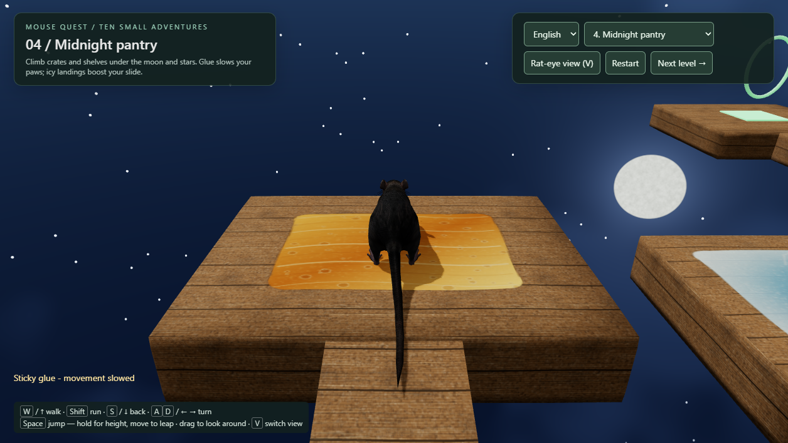

# Mouse Quest: rat parkour prototype

Guide a rigged, animated rat along narrow beams, across gaps and up stairs to the
green goal pad. If you fall, you start again from the beginning. It runs in the
browser with [three.js](https://threejs.org/).

Courses float above sky, green-lit depths, or fiery voids; Midnight Pantry has a
starry night sky and a cratered moon. Weathered platforms have subtle bevels and
surface relief. Amber glue appears as glossy, bubbly puddles; ice has frosted rims
and branching cracks. Ice is spread across more landing pads, with dry margins.
Landing on ice transfers horizontal jump velocity into a slide with a one-time
25% speed boost (capped at 3.2 m/s); friction then slows it, even after releasing
movement. A stationary jump stays stationary. Glue still slows walking and leaps.



Ten courses: the original scramble, a branching pipe labyrinth, rooftops, pantry shelves, spillway grates, the escape, a three-lap Corkscrew Tower, the four-storey Tangled Skyworks, the Abyssal Labyrinth, and the Clockwork Crossing. Level 10 introduces shuttles, an elevator and a rotating turntable: cyan stripes mark moving platforms, which carry you while grounded. Restart resets their timing. Level 9 has four branching maze decks, switchback ramps, dead ends, crate hurdles, broken bridges and open void shafts; there is no safety floor. Surfaces use procedural concrete, metal, brick, wood, and grate textures. Choose any course from the level selector, or reach its green beacon and press Space to advance. The Restart button retries the current course. Rooftop and pantry routes include inclined walkways. Amber striped glue slows movement and shortens moving leaps; blue striped wet patches retain momentum, so brake early. The two tower levels have overlapping routes, numbered landings, catch floors and return ramps; falling can cost height without ending your run. Patches affect the rat only while its feet touch them.

Choose English or Čeština in the language menu. Czech localization uses the title **Příběh krysy** and translates all ten levels, controls and game messages. Your choice is remembered; Czech browser language selects Czech on the first visit.

## Play

Once GitHub Pages is enabled (see [Deploy](#deploy-to-github-pages)), the game is at
`https://<your-user>.github.io/<this-repo>/`, and the animation viewer is at
`…/models/rat/viewer/`.

| Key | Action |
|---|---|
| W / ↑ | walk forward |
| Shift + W | run |
| S / ↓ | walk backward |
| A D / ← → | turn |
| Space | jump: hold for higher; while moving it's a leap (running leaps go about 1 m) |
| E / R / F | eat / rear up / sniff (hold) |
| X | play dead |
| V | toggle chase / rat-eye first-person camera |

Tips:
- Tap Space for a short hop.
- You climb the stairs with a moving leap (W + Space).
- The last gap needs a running leap with Space held.

## Run locally

Requires [Node.js](https://nodejs.org/) 24.

```bash
npm install
npm run game          # http://localhost:5180/game/  (viewer: /models/rat/viewer/)
npm test              # unit tests: collision, controller, level, site build
```

Headless browser checks (need a local Edge or Chrome):

```bash
npm run check:game
npm run check:viewer
```

## Deploy to GitHub Pages

1. Push the repository to GitHub.
2. In the repo, open **Settings → Pages → Build and deployment** and set **Source** to **GitHub Actions**.
3. Push to `master` (or run the **Deploy to GitHub Pages** workflow by hand).

The workflow (`.github/workflows/pages.yml`) runs the tests and `npm run build:site`, then
publishes `dist/`. Build and preview the same site locally with `npm run preview:site`
(http://localhost:5181/).

## Project layout

```
game/                 the parkour game: page, box collision, level data
models/rat/viewer/    animation viewer + shared modules (keyboard controller, crossfades, camera)
models/rat/dist/      rat.glb: the rigged, animated rat (46 joints, 14 clips)
models/rat/pipeline/  headless Blender pipeline that builds rat.glb
tools/                site build script, headless browser checks
docs/superpowers/     design specs and implementation plans
```

### The rat asset pipeline

`models/rat/pipeline/build.sh` turns a static rat mesh into `rat.glb` using Blender 5.2
headless:
1. Clean the mesh.
2. Rebuild a 46-bone skeleton from the mesh's vertex-group weights.
3. Generate 14 procedural clips: idle, sniff, walk, run, jump, turns, rear, eat and death. They use IK feet that stay planted.
4. Export the GLB.
5. Optimise it with gltf-transform.

The source mesh is not included (see the license section), so the pipeline only runs
if you supply a compatible mesh in `models/rat/cgtrader/`. Its Python tests run with
`python -m pytest models/rat/pipeline/tests`.

## License

The code is released under the [MIT License](LICENSE).

The rat 3D model (`models/rat/dist/rat.glb` and `models/rat/rat.png`) is a third-party
asset derived from a CGTrader model. It is **not** covered by the MIT License. See
[models/rat/MODEL-LICENSE.md](models/rat/MODEL-LICENSE.md).
